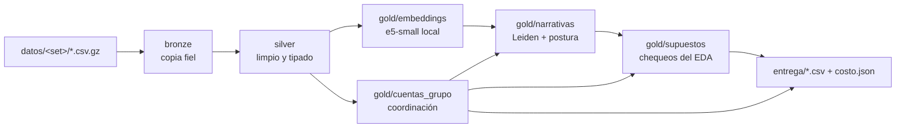

# Arquitectura

Un comando corre todo: `python -m qd --datos datos/final --entrega entrega`. Cada etapa lee
la capa anterior desde Parquet y escribe la suya; se puede cortar con `--hasta <etapa>`.

## Por qué medallion

| Capa | Qué garantiza | Para qué sirve |
|---|---|---|
| bronze | Ninguna fila se pierde; cada una sabe de qué archivo y línea vino (`_archivo`, `_fila`, `_hash`). | Auditar y re-procesar sin volver a leer los CSV. |
| silver | Tipos correctos, hora argentina, duplicados resueltos, cada problema anotado en `flags` (no se borra nada en silencio). | Un único lugar donde se resuelve la suciedad; el análisis no la vuelve a ver. |
| gold | Resultados del análisis, uno por tabla. | Entrega, dashboard y diagnóstico. |

## Por qué DuckDB + Parquet

- **Columnar y embebido**: no hay servidor que levantar; el jurado clona y corre. Las consultas
  de coordinación (3,7 millones de pares de cuentas con ventanas de tiempo) tardan ~2,5 s.
- **Parquet abierto**: cualquier herramienta (pandas, Spark, BigQuery, Athena) lee las capas.
- **Escala**: el mismo SQL corre sobre Parquet particionado por día en un bucket. Para millones
  de comentarios por día: ingesta diaria a bronze particionado, embeddings incrementales (hay
  caché por `texto_id`: un texto ya visto no se vuelve a embeber) y coordinación por ventana
  móvil de días. Si hiciera falta un servidor, MotherDuck o ClickHouse leen el mismo Parquet.

## Módulos

| Módulo | Etapa | Lee | Escribe |
|---|---|---|---|
| `qd/__main__.py` | orquesta | — | todo, más `costo.json` |
| `qd/lago.py` | — | — | utilidades: rutas, conexión, `COPY` a Parquet, catálogo |
| `qd/bronze.py` | bronze | CSV | `bronze/*` |
| `qd/texto.py` | — | — | limpieza y normalización de texto |
| `qd/silver.py` | silver | `bronze/*` | `silver/*`, `calidad.json` |
| `qd/embeddings.py` | embeddings | `silver/textos` | `gold/embeddings` |
| `qd/coordinacion.py` | coordinación | `silver/comentarios` | `gold/cuentas_grupo`, `gold/pares_coordinados` |
| `qd/narrativas.py` | narrativas | `silver/*`, `gold/embeddings`, `gold/cuentas_grupo` | `gold/comentarios_narrativa`, `gold/narrativas`, `gold/micro_clusters` |
| `qd/postura.py` | narrativas | — | decide qué lado afirma |
| `qd/llm.py` | narrativas | — | LLM local opcional (Qwen 7B vía MLX) |
| `qd/supuestos.py` | supuestos | `silver/*`, `gold/*` | `gold/supuestos` (avisa si algo del EDA no se cumple) |
| `qd/entrega.py` | entrega | `gold/*` | `entrega/*.csv` |
| `qd/huella.py` | entrega / verificación | datos y `entrega/` | SHA256 de entradas y salidas y commit en `costo.json`; `make verificar` re-corre y compara |
| `qd/secretos.py` | — | — | claves desde entorno, `.env` o Kaggle Secrets |
| `qd/validacion.py` | validación | `datos/practica` + verdad | `salida/validacion/*` |
| `qd/diccionario.py` | documentación | lago | `docs/datos.md` |

La coordinación corre antes que las narrativas porque la postura usa las campañas detectadas
(el lado que empuja una operación es el que afirma).
